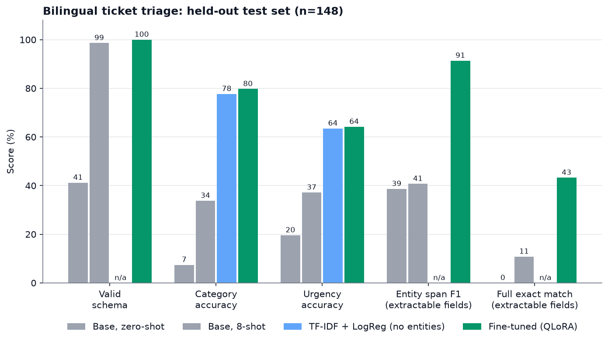
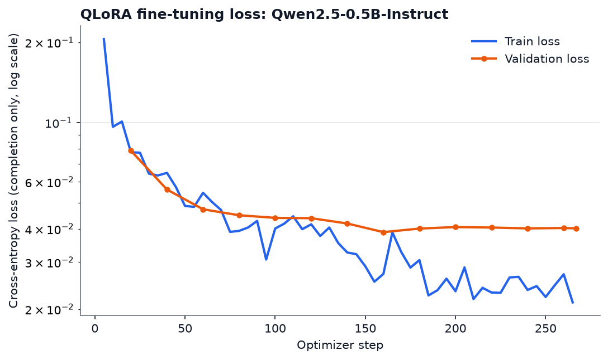
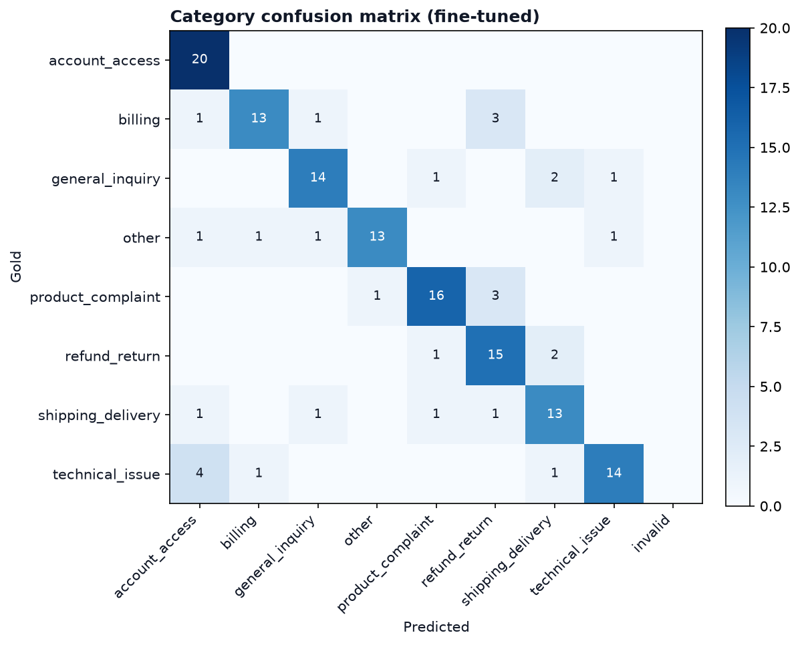

# Ticket Triage with a QLoRA-Tuned Small Language Model

Fine-tuning **Qwen2.5-0.5B-Instruct** with **QLoRA** (4-bit NF4 + LoRA) to read customer-support tickets written in **English and Roman-Urdu** (including code-mixed text) and return a strict JSON object: ticket **category**, **urgency**, and extracted **entities** (order ID, product name, account email, sentiment).

The whole pipeline (data prep, training, evaluation, adapter merge) runs on a **4 GB laptop GPU (RTX 2050)** in about 16 minutes.



## Results

Held-out test split, n = 148, greedy decoding, strict output validation (the *entire* response must be one schema-valid JSON object; trailing text, unknown keys or out-of-vocabulary labels all count as failures, and failures count as wrong in every accuracy metric).

| System | Schema-valid | Category acc | Urgency acc | Entity F1 (extractable)¹ | Full exact (extractable)¹ |
|---|---:|---:|---:|---:|---:|
| Base, zero-shot | 41.2 | 7.4 | 19.6 | 38.7 | 0.0 |
| Base, 8-shot (1 example per category) | 98.6 | 33.8 | 37.2 | 40.7 | 10.8 |
| TF-IDF + logistic regression (category/urgency only, no entities) | n/a | 77.7 | 63.5 | n/a | n/a |
| **Fine-tuned (QLoRA adapter)** | **100.0** | **79.7** | **64.2** | **91.4** | **43.2** |
| Fine-tuned, merged into base (bf16) | 98.0 | 76.4 | 64.2 | 92.7 | 38.5 |

**The fine-tuned LLM does not clearly beat a TF-IDF baseline on classification.** The classical model (word + character n-grams, logistic regression, regularisation chosen on the validation split) scores 77.7% category / 63.5% urgency against 79.7% / 64.2% for the QLoRA model. With n = 148 that gap is 3 tickets and well inside noise (the 95% interval on a ~78% accuracy is roughly ±7 points). So on category and urgency alone, a 0.5B LLM is not justified over a model that trains in seconds on a CPU. What the fine-tuned model adds is that **one model does classification, entity extraction and strict-JSON formatting together** (91.4% entity F1 on extractable fields, 100% schema-valid output), which the baseline cannot do at all. The ~80% ceiling on category looks like label ambiguity rather than model capacity: two very different model families land in the same place.

Category macro-F1 is 79.6%. Accuracy is similar on English (80.3%) and Roman-Urdu (79.3%) tickets (language split is a wordlist heuristic, see Limitations). Per-class metrics, the confusion matrix and every raw model output are in [`results/`](results/).

¹ **Read this before trusting the entity numbers, see [A dataset problem I found](#a-dataset-problem-i-found).**

Training: 3 epochs, 267 optimizer steps, 8.8 M trainable parameters (1.75% of 503 M), 954 s, final validation loss 0.040.



The loss curve shows mild overfitting after roughly step 160 (validation flat at about 0.040 while train loss keeps falling). I kept the final checkpoint rather than the best one; early stopping or fewer epochs would be a sensible refinement.



Remaining category errors are mostly genuinely ambiguous tickets. For example, an expired-product complaint that also asks for a refund is labelled `product_complaint` but predicted `refund_return`. Urgency errors are almost all adjacent-level confusions (high ↔ medium, low ↔ medium); only 4 of 53 `high` tickets were predicted `low`.

## A dataset problem I found

The dataset ([`abuzarkhan/bilingual-ticket-triage-dataset`](https://huggingface.co/datasets/abuzarkhan/bilingual-ticket-triage-dataset)) has entity labels that are **inconsistent between splits**:

| Split | Non-null entity values | Appear verbatim in the ticket text |
|---|---:|---:|
| train | 322 | 100% |
| validation | 34 | 100% |
| **test** | 259 | **~17%** (emails: 3 of 111) |

In train and validation, every labelled entity is actually present in the ticket. In the test split most are not, so no model could extract them. For example, a ticket about expired chips whose gold label contains an email address that appears nowhere in the text. Scoring a model against those labels measures nothing about extraction.

So the table reports entity metrics restricted to **extractable fields** (gold value is null or appears in the ticket). The unrestricted ("all fields") numbers are also kept in `results/` for transparency: fine-tuned entity F1 is 24.8% on all fields versus 91.4% on extractable ones. An error breakdown confirms it: of ~225 entity-field mismatches on the test set, only ~8 were real model errors (6 missed, 1 wrong, 1 hallucinated); the rest were unrecoverable labels. I did **not** modify the test labels. Category and urgency are scored on the labels as given, and I have no way to verify those for the same issue, so treat them as an honest lower bound.

## What went wrong the first time (and the fixes)

My first run scored **51% valid JSON / 32% category accuracy**. Debugging the raw outputs showed the model was undertrained and being taught the wrong thing:

| Problem | Evidence | Fix |
|---|---|---|
| System prompt said `"entities": {}`; the real schema was never shown | Model invented keys (`price`, `page_url`) and fake values (`info@example.com`) | Prompt now spells out the full schema and label sets |
| Loss computed over the **whole sequence** (system prompt + ticket + answer) | Validation loss stuck at 0.59 | Switched to prompt/completion format so loss is on the JSON answer only (now 0.040) |
| Only 2 epochs | Stray trailing `)`/`"`, invented categories like `payment_incomplete` | 3 epochs |
| Evaluation ignored entities entirely, and the base model was unfairly weak | Only category/urgency were scored | Added entity metrics, a few-shot baseline, and strict schema validation |

Result: valid JSON 51% → 100%, category accuracy 32% → 80%. I changed these together and did not ablate them, so I can't say how much each fix contributed.

## Repo layout

```
src/
  prepare_data.py   download dataset, build prompt/completion pairs + data/meta.json
  train.py          QLoRA SFT (TRL + PEFT + bitsandbytes), writes results/train_*.json
  evaluate.py       zero-shot / few-shot / fine-tuned / merged on the test split; strict validation
  merge_adapter.py  merge the LoRA adapter into the base weights
  baseline.py       TF-IDF + logistic-regression classifier baseline (category/urgency only)
  report.py         render charts + results table from results/*.json (no GPU needed)
  common.py         prompt, pydantic schema, metrics (torch-free, unit-tested)
  plots.py          chart helpers
tests/              17 unit tests for parsing, scoring and the grounded-entity metric
results/            metrics JSON, raw predictions (JSONL), training log, results table
assets/             charts used above
```

## Reproduce

```bash
uv sync
python src/prepare_data.py                    # build data/
python src/train.py                           # ~16 min on a 4 GB GPU
python src/merge_adapter.py                   # optional: merged bf16 model
python src/evaluate.py --merged outputs/qwen2.5-0.5b-triage-merged
python src/report.py                          # charts + table
python -m pytest tests                        # unit tests, no GPU needed
```

`python src/evaluate.py --rescore` recomputes metrics from the saved raw outputs without loading a model. Model weights and the processed dataset are not committed (they are regenerable and large). Seed is fixed at 42.

## Limitations

- **Small, synthetic-looking dataset** (1,414 train tickets) and a held-out test set of 148. Differences of a few points are within noise; no confidence intervals or multiple seeds yet.
- **Test-set entity labels are unreliable** (above), so entity results are on a filtered subset by design.
- **Language split is a wordlist heuristic**, not ground truth. It can mislabel Urdu-script tickets as English.
- The 0.5B model plateaus on urgency (64%); urgency is subjective, so some of that gap is probably label noise rather than model capacity. A 1.5B model is the obvious next experiment but needs a longer run on this GPU.
- The few-shot baseline uses one fixed example per category; a tuned prompt or larger base model would be a stronger comparison.
- The merged bf16 model is about 3 points lower on category than the 4-bit adapter it was merged from (my guess is that the adapter was trained against the NF4-quantized base and merging into full-precision weights shifts them slightly, but I haven't verified that).
- The TF-IDF baseline does not extract entities, so the entity comparison is only against the base LLM. A fairer entity baseline would be regex for order IDs and emails plus a token-classification model for product names; I haven't built it.

## Stack

Python 3.13 · PyTorch · Transformers · PEFT · TRL · bitsandbytes · Datasets · Pydantic · Matplotlib
